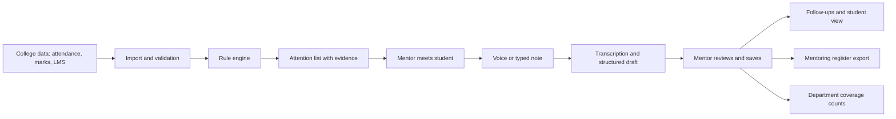

# Ten-Minute Mentor

> **Working title.** Rename freely.
> Early warning and a light log for faculty mentors. Built for **Deviathon**, problem statement **IM-104** (Integraminds, Tech for Impact, Software track).

A faculty mentor opens one screen, sees which students need a conversation and **why**, then records the outcome by voice in Tamil or English. Follow-ups and the accreditation mentoring register are generated automatically.

---

## 1. The problem

Most colleges assign each faculty member about 20 mentees and expect regular meetings, partly because accreditation reviews ask for evidence of mentoring. In practice:

- The signals that a student needs help (attendance, internal assessment marks, LMS activity) sit in separate systems, and nobody combines them. Mentors find out at the end of the semester, when the student is detained or has a backlog.
- Mentors teach full timetables and cannot dig through four systems for twenty students.
- The mentoring record is a paper register or a form filled in the week before an audit. It is written for auditors, not to help students.
- Students never see their own mentoring record or what was agreed.

## 2. What we are building

A **phone-first progressive web app (PWA)** with three role-based views:

| View | User | Device | Purpose |
|---|---|---|---|
| **Mentor** | Faculty mentor | Phone | Weekly attention list, student profiles, voice logging, follow-ups, register export |
| **Student** | Mentee | Phone | Their own mentoring history, agreed actions and next follow-up date |
| **Department** | Head of department / IQAC coordinator | Laptop | Aggregate coverage only: students reached, meetings logged, pending follow-ups |

### Core capabilities

1. **Attention list.** Combines attendance, internal marks and LMS activity into a short "who needs a conversation this week" list.
2. **Evidence for every alert.** Each alert names the signals behind it (for example "attendance 68% in 3 subjects, internal marks down 18 points") and shows the trend over time.
3. **Voice-to-record.** Tamil and English voice notes become an editable meeting summary with actions and a follow-up date. A typed note is always available as a fallback.
4. **Privacy by design.** Private student records and an aggregate-only department view.
5. **Register export.** The mentoring register comes out as a by-product in the format of at least one of the three sample colleges.

### Definition of done (from the brief)

- [ ] In a user test, a mentor reviews 20 mentees and logs 3 meetings in **under 10 minutes**.
- [ ] Every alert names the signals behind it.
- [ ] Tamil and English voice notes become structured logs with an action and a follow-up date.
- [ ] The mentoring register is generated in the format of at least one of the three sample colleges.
- [ ] Students see their own record, and no student sees anyone else's.

### How it is judged

Usefulness to a real faculty mentor matters most. The sponsor will run a short test with faculty. The winning team gets a paid pilot inside the Integraminds platform, and every finalist gets internship interviews.

---

## 3. Guardrails (non-negotiable)

| Area | Rule | How we meet it |
|---|---|---|
| **Technology** | Explainable rules or models only. No unexplained risk scores. | Transparent rule engine. No ML model, no hidden numeric score. The list is ordered by rule severity and recency, and every rule shows its reason in plain language. |
| **Privacy** | No student ranking or comparison shown to other students. Heads of department see coverage, not private notes. | Role-based access enforced on the server. The department API returns counts only. Students can only query their own record. |
| **Deployment** | Works on a basic Android phone. | Lightweight bundle, no heavy chart libraries, tested on a low-end Android in daylight. |

---

## 4. How it works



### Alert rules (explainable, configurable thresholds)

Starting rule set. Thresholds are defaults and will be tuned with faculty input.

| Rule | Example reason shown to the mentor |
|---|---|
| Low attendance in one or more subjects | "Attendance 68% in 3 subjects" |
| Sharp attendance drop over recent weeks | "Attendance fell from 82% to 61% in 3 weeks" |
| Internal marks decline | "Internal marks down 18 points since last test" |
| LMS inactivity | "No LMS activity in 14 days" |
| Overdue follow-up | "Follow-up from 12 Oct is 9 days overdue" |
| Not met recently | "Not met in 5 weeks" |

Placement-training attendance is mentioned in the brief as a signal, but it is not in the supplied dataset. Treat it as a stretch rule.

### Voice logging flow

1. The mentor picks a language (Tamil or English) and records. A typed note is always available.
2. Audio is transcribed to text.
3. An LLM extracts a structured draft: summary, topics, actions, follow-up date. Output is validated against a strict schema.
4. Relative dates ("next Friday") are resolved in code against the meeting date, and the mentor confirms them in a date picker.
5. The mentor edits and confirms. **Nothing is saved until the mentor confirms.**
6. If transcription or extraction fails, the mentor still gets the raw transcript or a blank form. The log is never lost.

---

## 5. Screens

1. **Mentor home** shows students needing attention with reasons, overdue follow-ups and weekly review progress.
2. **Student profile** shows attendance, marks and activity trends, previous conversations and agreed actions.
3. **Log conversation** has Tamil/English selection, a record button, a typed-note alternative and an editable AI draft.
4. **Follow-ups and register** shows due actions, completion controls and register export.
5. **Student view** shows their mentoring history, next action and follow-up date.
6. **Department view** shows aggregate coverage: students reached, meetings logged and pending follow-ups.

Mentor navigation: bottom tabs **This Week · Students · Follow-ups**.

---

## 6. Tech stack (proposed)

> Nothing has been locked yet. Confirm or change this in the first alignment session.

| Layer | Choice | Why |
|---|---|---|
| **App framework** | Next.js (App Router) + TypeScript, one codebase for UI and API | One directory, one install, one deploy. Server rendering keeps client JavaScript small for low-end phones. |
| **UI** | Tailwind CSS, Radix UI primitives (restyled), TanStack Query | Accessible sheets, dialogs and forms without a stock look. |
| **PWA** | Web app manifest + service worker (e.g. Serwist), MediaRecorder API for audio | Installable on Android with no app store. |
| **Charts** | Inline SVG sparklines | Avoids heavy chart libraries on basic phones. |
| **Backend** | Next.js route handlers (`src/app/api`) calling server-only modules, Zod for validation | Same language and types as the frontend, so API shapes cannot drift. |
| **Database** | PostgreSQL with Drizzle or Prisma | Relational model fits students, meetings and follow-ups. |
| **Data import** | CSV parser (e.g. Papa Parse) for the synthetic dataset, adapter for the ITLF classroom engagement export (sandbox) with CSV fallback | The brief supplies a dataset and a sandbox API. |
| **Auth** | JWT with role claims (`MENTOR`, `STUDENT`, `HOD`) | Role checks happen server-side on every request. |
| **Speech-to-text** | To be chosen after a Tamil/English benchmark. Candidates include Sarvam AI, Whisper (hosted or self-run) and Google Speech-to-Text | Tamil accuracy, including Tamil-English mixed speech, decides this. |
| **Note extraction** | LLM with JSON-schema output, validated with Zod | Structured, editable output with a safe failure path. |
| **Register export** | `docx` and `exceljs` packages (PDF if the chosen format needs it) | Match one of the three supplied college formats exactly. |
| **Testing** | Vitest, Playwright, Lighthouse, real-device check | Covers integration tests and the 10-minute user test. |
| **Hosting** | Single deploy on Vercel (or any Node host), Postgres on Neon or Supabase (free tiers) | Quick to deploy for a 48-hour build. Transcription runs as upload then status polling, so request time limits do not matter. |

**Login for the demo:** mobile number plus OTP with a fixed test OTP. This is a stand-in. A real college deployment would use institutional email or SSO.

---

## 7. Design principles

The product should look designed, not templated.

- **Light theme only.** Faculty use phones in bright classrooms.
- **Design tokens first.** One accent color (deep teal or blue), a gray scale for everything else, and red/amber/green reserved for alert severity only. One spacing scale (4/8/12/16/24), one corner radius, thin borders instead of shadows.
- **Compact rows, not big cards.** The student list is a scannable row: status dot, name, one-line reason, last-met date. This is what makes 20 students in 10 minutes possible.
- **Tamil-ready typography.** Pair the Latin font with **Noto Sans Tamil** so Tamil text never falls back to a system font.
- **Large touch targets** (48px minimum) and 16px+ base text.
- **Real content.** Realistic Tamil and English student names and believable alert reasons, never "John Doe".
- **Design the unhappy states.** Empty list, loading, offline, microphone permission denied, transcription failed, wrong AI draft.
- **Plain, warm language.** No slang, no marketing copy.
- **One icon set** (Lucide or Material). No emojis as icons.

---

## 8. Team and responsibilities

| Role | Owner | Responsibilities |
|---|---|---|
| **Frontend developer** | _name_ | Responsive screens, navigation, recording controls, forms, API integration |
| **Backend developer** | _name_ | Database, login and access rules, data import, explainable alerts, meeting records, follow-ups, register export |
| **Product and evaluation lead (researcher)** | _name_ | Faculty interviews, workflow and wireframes, realistic sample data, rule justification, register requirements, usability testing, pitch evidence |
| **AI integration and testing developer** | _name_ | Tamil/English transcription, structured-note extraction, AI failure handling, integration tests, deployment checks |

---

## 9. 48-hour plan

| Hours | Focus |
|---|---|
| **0-4** | Agree on screens, data fields, API responses and one demo story |
| **4-16** | Frontend runs on sample responses. Backend builds data model and alerts. AI dev proves Tamil/English transcription. Researcher prepares scenarios and 20 realistic mentees |
| **16-28** | Connect the full journey: student alert → voice recap → reviewed record → follow-up |
| **28-38** | Student and department views, access checks, register export |
| **38-44** | Timed faculty tests, basic Android check, fix failures |
| **44-48** | Freeze features, rehearse the demo, prepare the final presentation |

**Demo story (draft):** A mentor opens the app on a phone, sees an alert for a student whose attendance and internal marks have both dropped, opens the evidence, records a 30-second Tamil voice note, reviews the AI draft, saves it, and exports the register. The student then opens their own page and sees the agreed action.

---

## 10. Out of scope

Deliberately excluded to keep the 48-hour build focused:

- Predictive ML risk scores (the brief requires explainable rules only)
- Student ranking or any peer comparison
- A student wellbeing or mood check-in (not in the brief)
- Real SSO or production LMS integration beyond the supplied sandbox
- A native mobile app

---

## 11. Open questions

- [ ] Which of the three sample college register formats do we target first?
- [ ] Do we get access to the ITLF classroom engagement sandbox early enough to integrate, or do we start from the synthetic dataset and CSV?
- [ ] Which speech-to-text service gives the best Tamil accuracy on our test clips?
- [ ] Is audio deleted right after transcription? (Recommended: yes, keep only the confirmed text.)
- [ ] Will the student view be English only, or do we add Tamil labels?

---

## 12. Planned project structure

One Next.js app, one directory, one `package.json`. The UI and the API live side by side.

```
ten-minute-mentor/
├── src/
│   ├── app/                 # Next.js App Router
│   │   ├── mentor/          # This Week, Students, Log conversation, Follow-ups
│   │   ├── student/         # student view
│   │   ├── department/      # department view
│   │   ├── login/
│   │   └── api/             # route handlers (the backend endpoints)
│   ├── components/          # shared UI components
│   ├── server/              # server-only code, never shipped to the browser
│   │   ├── db/              # schema, migrations, queries
│   │   ├── auth/            # JWT, role checks
│   │   ├── alerts/          # explainable rule engine
│   │   ├── import/          # synthetic dataset and ITLF adapters
│   │   ├── ai/              # transcription, note extraction, failure handling
│   │   └── register/        # register export
│   └── lib/                 # shared types, validation schemas, design tokens
├── data/                    # synthetic dataset, register templates
├── public/                  # PWA manifest, icons
├── tests/
├── docs/                    # wireframes, design tokens, rule justification
└── README.md
```

**Who works where (to avoid merge conflicts):**

- Frontend developer: `src/app/mentor`, `student`, `department`, `login`, and `src/components`
- Backend developer: `src/app/api`, `src/server/db`, `auth`, `alerts`, `import`, `register`
- AI integration developer: `src/server/ai` and `tests`
- Agree the request and response types in `src/lib` first. Both sides import them, so the API shapes cannot drift.

## 13. Getting started

> To be finalized once the project is scaffolded.

```bash
npm install
npm run dev
```

---

## Acknowledgements

Problem statement IM-104 by **Integraminds**, via **Deviathon**.
