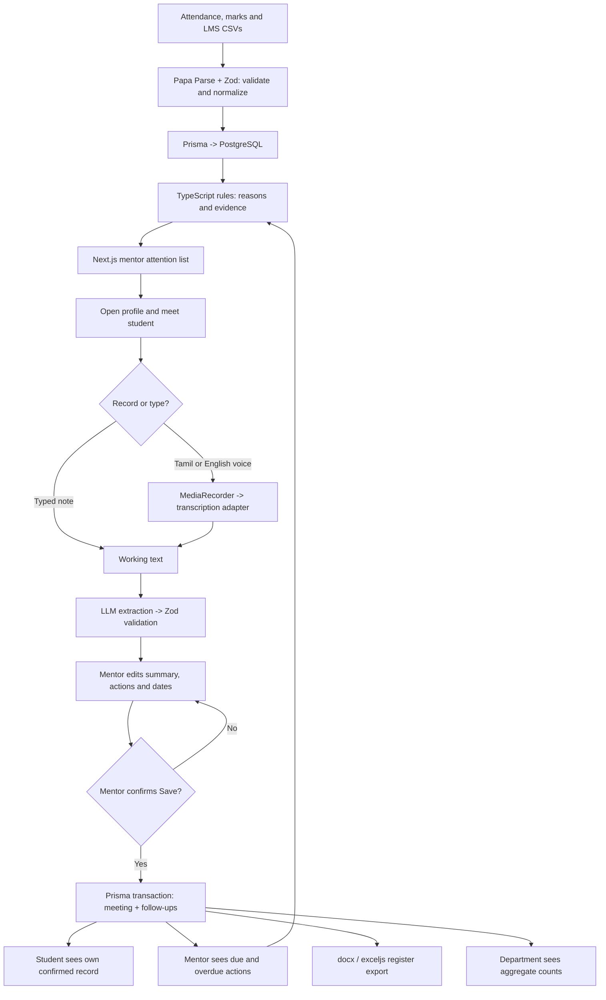
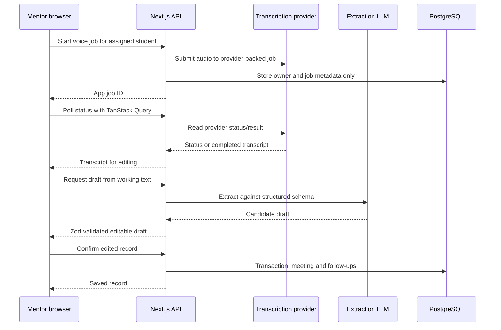

# Ten-Minute Mentor: workflow using the README stack

Planning deliverable for Deviathon IM-104. The target is a faculty mentor reviewing 20 mentees and logging three meetings in under ten minutes.

This workflow uses `README (3).md` as the product brief and `codex-prompt.md` as supporting context. Its scaffold and implementation prompts have not been executed. Prisma, `jose`, and Lucide resolve alternatives in the README; the speech and extraction providers still require evaluation.

## 1. Stack and responsibilities

| Layer | Selected technology | Responsibility |
|---|---|---|
| Application | Next.js App Router + TypeScript | One application containing pages and API route handlers |
| Interface | Tailwind CSS + Radix UI + Lucide | Accessible controls, compact student rows, sheets, forms and navigation |
| Browser data | TanStack Query | Interactive requests, job-status polling and refreshing lists after saves |
| Charts | Inline SVG | Attendance, marks and activity sparklines |
| PWA and recording | Manifest + Serwist + MediaRecorder API | Installation, a public offline screen and Tamil/English recording |
| Backend | Next.js route handlers + server-only TypeScript modules | Authorization, imports, alert rules, meeting records and exports |
| Validation | Zod | Runtime validation of imported data, requests and AI responses |
| Database | PostgreSQL + Prisma | Students, assignments, source signals, confirmed meetings and follow-ups |
| Authentication | `jose` JWT in an httpOnly cookie | Demo mobile/OTP login and verified identity on protected requests |
| CSV import | Papa Parse | Parse source files before Zod validation and normalized database writes |
| Transcription | `Transcriber` adapter | Mock initially; benchmark Sarvam, hosted Whisper and Google Speech-to-Text |
| Note extraction | `NoteExtractor` adapter + schema-capable LLM | Produce an editable structured draft; provider/model remains a measured choice |
| Export | `docx` and `exceljs` | Reproduce the supplied college register template |
| Verification | Vitest + Playwright + Lighthouse + Android user test | Rules, access controls, full journey, performance and actual usability |
| Deployment | Vercel + Neon PostgreSQL | Default hosting choices from the README's alternatives; local PostgreSQL via Docker |

Use Server Components for initial page rendering and Client Components for recording, editing and interactive lists. Server Components call authorized server modules directly. Browser requests use route handlers. Both entry points share the same authorization and business logic. This follows the documented Next.js server-data pattern. [Next.js backend guidance](https://nextjs.org/docs/app/guides/backend-for-frontend)

## 2. End-to-end product workflow

### Step 1: import college data

Run a trusted import script during the hackathon. Parse CSV files, validate them with Zod, match institutional student IDs and normalize subject, week and assessment fields. Show validation errors before committing the import. Reject invalid totals, impossible scores, unmatched IDs and duplicate source rows.

Use stable source keys to make repeat imports safe. Preserve the source timestamp and import time so alerts can show how recent their evidence is. Keep ITLF behind an import adapter; implement its real contract only after the sandbox documentation is supplied. Start with CSVs and deterministic synthetic data.

### Step 2: log in and load the appropriate view

The demo accepts mobile number plus the configured test OTP only when `DEMO_MODE=true`. Verify the credentials server-side, then issue a signed JWT in an httpOnly cookie with Secure in HTTPS deployments, SameSite and an expiry. Include logout and clear browser query data when the user changes.

Authorize every protected read and write using the database identity, role and current assignment. Mentor queries are restricted to assigned mentees; student identity comes from the authenticated session; HOD queries are restricted to their department and return aggregates. Validate the origin of cookie-authenticated mutations. Route redirects are convenience checks, while the server data layer enforces access. [Next.js authentication guidance](https://nextjs.org/docs/app/guides/authentication)

### Step 3: generate the attention list

For the mentor's assigned students, load attendance, assessment results, LMS activity, confirmed meetings and open follow-ups. Run six pure TypeScript rules with thresholds stored in one configuration file:

| Rule | Evidence shown |
|---|---|
| Low attendance | Percentage and affected subjects, e.g. “Attendance 68% in 3 subjects” |
| Attendance drop | Earlier and current percentages and the comparison period |
| Marks decline | Comparable assessments and the change in score or percentage points |
| LMS inactivity | Last known activity and elapsed days |
| Overdue follow-up | Agreed action, due date and days overdue |
| Not met recently | Last confirmed meeting and elapsed weeks |

Each result contains `ruleId`, `severity`, `reason`, `evidence` and `observedAt`. Group results by student, ordering by the highest triggered severity and then the latest relevant evidence. Show all reasons on the profile. There is no combined numeric risk score.

Missing or stale data is labelled as such; it must not silently count as poor attendance or inactivity. Compare marks on the same scale and handle zero attendance totals explicitly. Evaluate time-dependent rules when the list is requested so overdue dates remain current.

### Step 4: review the student and log the conversation

The mentor opens the evidence and trend sparklines, meets the student, then chooses Tamil/English recording or a typed note. Typed input can proceed directly to manual editing or optional extraction.

For voice, upload through an authorized endpoint, start transcription and show progress. The draft contains `summary`, `topics`, `actions` and proposed follow-up dates. Validate the extractor response with Zod. Treat the transcript as data, never as instructions to run tools or update records.

Resolve explicit relative dates in code using the meeting date and `Asia/Kolkata`. Keep ambiguous or absent dates unset and ask for them in the date picker. Do not invent actions or commitments. Before completing the demo log, the mentor supplies or confirms the agreed action and follow-up date.

The mentor can edit every field. Microphone denial, upload failure, transcription failure and invalid extraction all return to an editable form. Preserve available text in the current browser session. Unsaved drafts do not survive a closed tab in this MVP; do not promise recovery without implementing an explicit draft-storage policy.

### Step 5: confirm and save

Only the explicit Save action creates a meeting. Revalidate the payload and assignment server-side, set `confirmedAt` on the server, and create the meeting and its follow-ups in one Prisma transaction. Use a client submission ID with a uniqueness constraint so retries cannot create duplicate meetings.

Refresh the mentor's lists after success. Persist confirmed text and actions, not raw recordings or unconfirmed AI drafts. Student-facing data contains only that student's confirmed record. Department responses contain counts, never individual records or transcripts.

### Step 6: follow up, export and measure coverage

The mentor sees due and overdue actions and can mark an action complete. Completion records its timestamp and removes that action's overdue alert. Follow-ups are shown inside the app; messaging integrations are outside this workflow.

Export only confirmed meetings within the selected scope and dates. The template adapter maps fields into one actual supplied college format. Exact register layout remains pending until that sample is available; an invented template does not satisfy the brief.

For the chosen reporting period, department coverage includes distinct assigned students reached, confirmed meeting count and pending follow-ups. Define the denominator and date filters consistently so repeated meetings do not inflate “students reached.”

## 3. Voice processing and hosting

Polling is a status mechanism, not a background execution mechanism. The recommended asynchronous path uses a transcription provider that owns the running job. Sarvam's batch API documents job submission, status polling and result retrieval, making it a candidate for this adapter; this is not evidence that its latency or Tamil accuracy meets the product target. [Sarvam batch API](https://docs.sarvam.ai/api/api-guides-tutorials/speech-to-text/batch-api)

Keep job IDs, ownership, provider references, expiry and status in PostgreSQL. Authorize status and result access just like student records. Each Next.js request performs bounded work; do not start an unawaited in-memory task and assume it survives. Vercel still enforces invocation and payload limits. [Vercel function limits](https://vercel.com/docs/functions/limitations)

Benchmark short Tamil, English and mixed-language clips for names, actions, dates and total time until an editable draft. Select the provider only after that check. If the selected service supports only synchronous transcription, use a bounded awaited transcription request for short clips or add an explicitly designed durable worker before claiming asynchronous support. Mock mode exercises the same application states and is clearly labelled.

Delete application-controlled audio after transcription and clean up failed or abandoned uploads on expiry. Verify the chosen provider's audio/result deletion and retention controls separately; this workflow does not assume an undocumented deletion endpoint or guarantee. Temporary provider processing is distinct from the app's confirmed mentoring record. Do not put audio, transcripts or note content in application logs.

Cache only public assets and a public offline screen in the service worker. Exclude authenticated pages, React Server Component responses, API responses, recordings, transcripts and exports from persistent caches. Use private/no-store responses for protected data and do not persist TanStack Query data. Serwist exposes explicit caching strategies, including NetworkOnly. [Serwist caching strategies](https://serwist.pages.dev/docs/serwist/runtime-caching/caching-strategies)

## 4. Module and API boundaries

| Location | Responsibility |
|---|---|
| `src/app/mentor`, `student`, `department`, `login` | Role-specific screens |
| `src/app/api` | HTTP parsing, validation and calls into authorized server services |
| `src/components` | Shared rows, controls, forms, charts and states |
| `src/server/db`, `auth` | Prisma queries, transactions and authorization helpers |
| `src/server/import`, `alerts` | Source adapters, normalization and explainable rules |
| `src/server/ai` | Transcriber/extractor interfaces, mocks, provider adapters and cleanup |
| `src/server/register` | College-specific register mapping and file generation |
| `src/lib` | Shared Zod schemas, inferred types, date helpers and design tokens |
| `data`, `tests`, `docs` | Synthetic inputs/templates, verification and project documentation |

| Proposed endpoint | Purpose |
|---|---|
| `POST /api/auth/login`, `POST /api/auth/logout` | Demo session lifecycle |
| `GET /api/mentor/attention` | Assigned students needing attention, with evidence |
| `GET /api/mentor/students`, `GET /api/mentor/students/[id]` | Mentee list and authorized profile |
| `POST /api/mentor/voice-jobs` | Create a transcription job |
| `GET /api/mentor/voice-jobs/[id]` | Read owned job status and available result |
| `POST /api/mentor/note-draft` | Extract and validate an editable draft |
| `POST /api/mentor/meetings` | Save a confirmed meeting and follow-ups atomically |
| `GET /api/mentor/follow-ups`, `PATCH /api/mentor/follow-ups/[id]` | Read and complete assigned follow-ups |
| `GET /api/mentor/register` | Export authorized confirmed records |
| `GET /api/student/me` | Own confirmed history and actions |
| `GET /api/department/coverage` | Department aggregate metrics |

Core entities: `User`, `Department`, `Student`, `MentorAssignment`, `AttendanceRecord`, `InternalMark`, `LmsActivity`, `Meeting` and `FollowUp`. Add an operational `VoiceJob` record for the asynchronous path. Keep its transient status metadata separate from confirmed academic records.

## 5. Build workflow for the 48-hour sprint

| Time | Build increment | Exit condition |
|---|---|---|
| Hours 0–4 | Agree Zod/API contracts, rule configuration, design tokens and demo scenario | Shared data shapes; one mentor with exactly 20 reproducible mentees planned |
| Hours 4–16 | Scaffold, Prisma schema, seed/import, auth, alert engine, mentor lists and profile | Mentor sees 20 assigned students; every alert has evidence; access and rule tests pass |
| Hours 16–28 | Typed logging, mock voice flow, provider benchmark, extraction and confirmation transaction | A meeting produces a confirmed record and follow-up; failure paths remain editable |
| Hours 28–38 | Follow-ups, student view, department aggregates and actual register template | Correct access boundaries and a verified export using the supplied format |
| Hours 38–44 | PWA, mobile polish, Playwright, Lighthouse and timed faculty test | Review 20 mentees and log three meetings on a basic Android phone; fix observed failures |
| Hours 44–48 | Feature freeze, clean setup verification, deployment check and rehearsal | Repeatable demo and documented limitations |

Frontend owns screens and components; backend owns data, authorization, imports, rules and exports; AI/testing owns provider adapters and integration failures; product/evaluation owns faculty scenarios, register requirements and usability evidence. Agree shared schemas before independent implementation.

At each completed increment, run type checking, lint and the relevant Vitest suite. Run a production build before deployment. Test every alert rule, record ownership, department isolation, relative-date handling and retry-safe saves. Use Playwright for the full path, but measure the ten-minute requirement with an actual mentor: a scripted run is not a substitute for that user test.

Use a light theme, deep teal accent, Noto Sans Tamil alongside the Latin font, at least 16px text and 48px touch targets. Check screens at 360px width and on a real phone. Keep severity colors for alerts and provide loading, empty, offline, error and permission-denied states.

## 6. Decisions remaining before the real integrations

- Speech provider: benchmark accuracy, short-note latency, supported browser audio formats and retention/deletion behavior.
- Extraction provider/model: verify structured output, Tamil handling, latency and data retention; keep the adapter mock available.
- Register: obtain one actual college sample and map its exact columns and layout.
- ITLF: obtain the real sandbox contract; use CSV import until then.
- Student labels: English-first UI with Tamil content support; Tamil interface labels remain a product choice.

The workflow is ready to guide implementation. These integration inputs do not prevent scaffolding, rule development, typed logging or mock-based end-to-end work.
